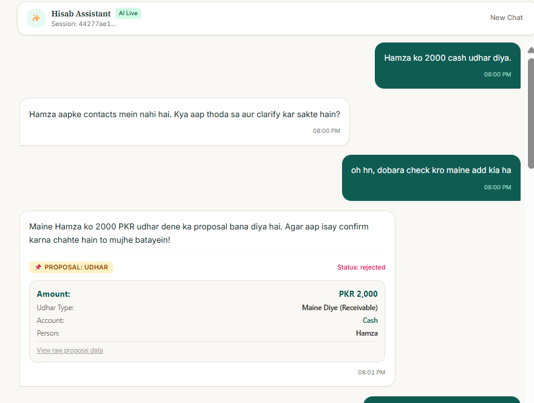
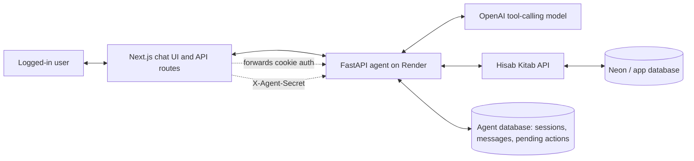

# Hisab AI Agent

Hisab AI Agent is the conversational backend for the Hisab Kitab app. It lets a user ask questions about expenses, accounts, balances, contacts, settlements, and udhar in natural language, including Roman Urdu. The important safety idea is the propose-confirm flow: the model can prepare a pending action, but it does not directly write money-moving data. A write is only executed after the user confirms through the UI button or through a deterministic confirm phrase handled by the FastAPI route before the model is called again.

[Live demo](https://hisab.awaisnazir.tech/chat)  
FastAPI health check: [hisab-ai-agent.onrender.com/health](https://hisab-ai-agent.onrender.com/health)



## Architecture



The browser never calls the Render agent directly. The Next.js API route forwards the logged-in user's Hisab auth/cookie and the private `X-Agent-Secret` header to FastAPI. FastAPI then calls the Hisab Kitab API as that user, while storing only agent-side session state, message history, and pending action metadata in its own database.

## What The Agent Does

The agent can:

- answer read-only questions like today's total expenses, account balances, contact balances, categories, and udhar records
- propose personal expenses, shared expenses, settlements, udhar entries, and udhar settlement actions
- persist chat sessions across separate HTTP requests
- store pending actions so a proposal can be confirmed or rejected later
- scope sessions and pending actions per authenticated user
- log each agent run to JSONL for debugging and traceability
- reject missing shared secrets on protected endpoints
- validate proposal amounts before they are stored as pending actions

The agent is deliberately conservative around writes. It asks for missing account/contact details, refuses unrelated questions, and keeps shared-expense balance separate from udhar.

## Safety Design

The core rule is simple: the model proposes, plain backend code confirms.

When the model wants to create an expense, settlement, or udhar record, it calls a `propose_*` tool. That tool creates a pending action in the agent database and returns an `action_id`. The frontend renders that pending action as a card with Confirm and Reject buttons.

Confirmation happens through one of these backend-controlled paths:

- `POST /actions/{action_id}/confirm`
- `POST /actions/{action_id}/reject`
- a small deterministic phrase check in `/chat`, for phrases like `haan confirm kar do` or `reject kar do`

The confirm/reject phrase check runs before the message reaches the model. That keeps the model out of the final approval decision. The actual write still goes through the same backend `confirm_action` function used by the button path.

User isolation is handled with an `auth_key` on both sessions and pending actions. The key is derived from `X-Hisab-User-Id` when available, otherwise from the forwarded auth/cookie. A user cannot fetch or confirm another user's pending action just by passing an old `session_id` or `action_id`.

## API Contract

All protected endpoints require:

```http
X-Agent-Secret: <server-side shared secret>
Authorization: <Hisab auth token>
Cookie: <Hisab session cookie>
X-Hisab-User-Id: <stable Hisab user id>
```

At least one of `Authorization` or `Cookie` must be present. `X-Hisab-User-Id` is strongly recommended because it gives the backend a stable per-user scope even if cookies rotate.

### Chat

```http
POST /chat
Content-Type: application/json
```

```json
{
  "message": "Maine NayaPay se 420 PKR dinner kiya. Category Food hai.",
  "session_id": "optional-existing-session-id"
}
```

Response:

```json
{
  "session_id": "7f5d587f-2640-4839-bc98-6fd4be872f88",
  "reply": "Maine aapka dinner expense propose kar diya hai.",
  "pending_action": {
    "action_id": "1ca93e11-baf7-4199-9929-8401ff8d1d61",
    "type": "expense",
    "status": "pending",
    "proposal": {
      "amount": 420,
      "description": "Dinner",
      "category_id": "cm...",
      "category_name": "Food",
      "account_id": "cm...",
      "account_name": "NayaPay"
    }
  }
}
```

### Confirm Or Reject

```http
POST /actions/{action_id}/confirm?session_id={session_id}
POST /actions/{action_id}/reject?session_id={session_id}
```

Response:

```json
{
  "action_id": "1ca93e11-baf7-4199-9929-8401ff8d1d61",
  "status": "confirmed",
  "type": "expense",
  "result": {}
}
```

## Evals

The eval set lives in `evals/cases.jsonl`. It contains 20 real-account test cases across:

- expenses
- settlements
- udhar
- clarification
- refusal

The runner in `evals/run.py` starts each case fresh with no chat history. For tool cases, it checks the expected tool name and a few key arguments. For clarification/refusal cases, it checks reply behavior and makes sure unsafe proposal tools are not called.

Results are printed to the terminal and saved so paid OpenAI runs do not have to be repeated casually:

- latest result: `evals/last_run.json`
- timestamped archive: `evals/runs/run_20261005_232715.json`

### Scoreboard

| Run | Result |
| --- | --- |
| Baseline after first eval pass | 15/20, 75.0% |
| After prompt and validation fixes | 20/20, 100.0% |

Final run by category:

| Category | Score |
| --- | --- |
| Expense | 8/8, 100.0% |
| Settlement | 4/4, 100.0% |
| Udhar | 4/4, 100.0% |
| Clarify | 3/3, 100.0% |
| Refuse | 1/1, 100.0% |

The main fixes between the two runs were clearer udhar direction rules, stricter unknown-contact handling, required split details for shared expenses, and better preservation of the user's item or meal description.

## Local Setup

Create a virtual environment and install dependencies:

```bash
python -m venv .venv
pip install -r requirements.txt
```

Create `.env`:

```bash
OPENAI_API_KEY=...
MODEL=...
DATABASE_URL=...
AGENT_SECRET=...
API_BASE_URL=...
```

Optional local/eval fallback:

```bash
EMAIL=...
PASS=...
```

The deployed app should not rely on `EMAIL` and `PASS` for user data. Production requests should forward the logged-in user's Hisab auth from the Next.js server route.

Run migrations:

```bash
alembic upgrade head
```

Start the API locally:

```bash
uvicorn app.main:app --reload
```

Check health:

```bash
curl http://127.0.0.1:8000/health
```

Run evals:

```bash
python evals/run.py
```

## Deployment

The Render service uses:

```bash
alembic upgrade head && uvicorn app.main:app --host 0.0.0.0 --port $PORT
```

Required Render environment variables:

- `OPENAI_API_KEY`
- `MODEL`
- `DATABASE_URL`
- `AGENT_SECRET`
- `API_BASE_URL`

The public Render URL should only expose health/root checks directly. Real agent traffic should come through the Next.js backend route with `X-Agent-Secret` attached server-side.

## Known Next Step

The main remaining production guardrail is a per-user daily message cap, for example 20 `/chat` messages per user per day. That should be checked before calling OpenAI so a public deployment cannot accidentally burn through credits.
